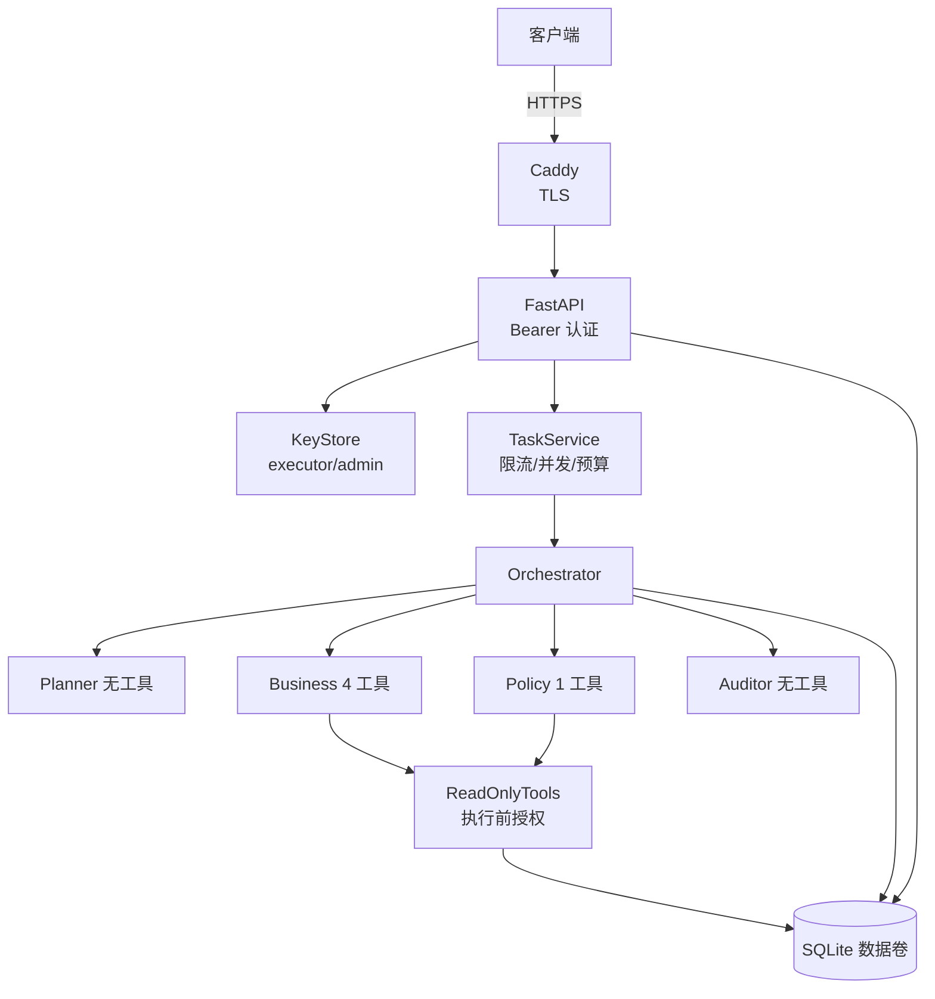

# Secure Agent Runtime & Deployment Gateway

> 把项目⑤的多 Agent 联合研判改造成**有边界、可管控、失败不越权**的内部服务。
> 全部业务数据虚构；Agent 只读；不执行任何业务写入。

[](https://github.com/haozhouliuliuliu/secure-agent-runtime/actions/workflows/ci.yml)
[](https://www.python.org/)
[](LICENSE)

## 业务场景

把 AI Agent 接进企业内部系统时，真正的难点不是“能不能回答”，而是：它能碰哪些数据、以谁的身份操作、失败时会不会越权、出了事能不能追溯、能不能安全地部署在内网。

这个项目以只读的多 Agent 联合研判为业务场景，补齐 API 身份、工具授权、预算/限流、日志脱敏、非 root 镜像、HTTPS 入口、备份恢复等边界。它适合作为 Agent 上线前的安全设计参考，也适合演示“权限收紧后功能仍然可用”。

## 项目背景

- 上游基线：https://github.com/haozhouliuliuliu/it-agent-collab（`v1.0.0` / `fb17bfc`）
- 本仓库独立，不修改上游；保留 MIT 许可证与来源说明（见 [UPSTREAM.md](UPSTREAM.md)）

早期多 Agent 原型解决了“怎么协作”，但离“能安全上线”还有距离：工具权限、身份、并发、日志、部署边界都不完整。本项目把这些控制补齐，适合作为企业内部 Agent 服务的上线前基线。

## 核心安全改动

| 原型中的风险 | 本项目的控制 |
|---|---|
| Business/Policy 都拿到全部工具 | **两层强制**：模型工具列表按角色过滤 + 执行前授权校验 |
| 无 API、无身份 | Bearer API key，executor/admin 角色，任务 owner 隔离 |
| CLI 顺序执行 | FastAPI + 并发服务，全局/单任务预算、限流、过载拒绝 |
| 日志可能含错误细节 | JSON 日志 + 密钥/Authorization 脱敏；客户端只看到稳定错误码 |
| 无部署边界 | 非 root 镜像、Compose + Caddy HTTPS、数据卷、健康检查 |
| 无备份/保留策略 | SQLite 在线备份/校验/恢复 CLI，任务清理与保留说明 |

## 工具权限矩阵（程序强制）

| Agent | 允许工具 |
|---|---|
| Planner | 无 |
| Business | `query_inventory`、`get_asset`、`get_ticket`、`list_tickets` |
| Policy | `search_policies` |
| Auditor | 无 |

```python
# src/team_agent/permissions.py
TOOL_ALLOWLIST = {
    "planner": frozenset(),
    "business": frozenset({"query_inventory", "get_asset", "get_ticket", "list_tickets"}),
    "policy": frozenset({"search_policies"}),
    "auditor": frozenset(),
}
```

- `ReadOnlyTools.schemas_for(agent)` 只把授权工具发给模型；
- `ReadOnlyTools.execute(agent, name, args)` 在执行前再次检查；越权抛 `TOOL_NOT_PERMITTED`，**不执行、不返回数据**；
- 越权与工具错误写入 `collab_events`（`tool_denied` / `tool_error`）；
- 提示词中的"禁止"不参与授权判断。

## 架构



## 快速开始

```bash
python -m venv .venv
.venv\Scripts\activate
pip install -e ".[dev]"

# 复制 .env.example，填写三类密钥；程序不自动加载 .env，请导出为环境变量
set SERVICE_API_KEYS=[{"key":"exec-key-change-me","user":"alice","role":"executor"},{"key":"admin-key-change-me","user":"admin","role":"admin"}]
set DEEPSEEK_API_KEY=...
set QWEN_API_KEY=...
set KIMI_API_KEY=...

secure-agent serve            # http://127.0.0.1:8000
```

```bash
# 提交任务
curl -X POST http://127.0.0.1:8000/v1/tasks \
  -H "Authorization: Bearer exec-key-change-me" \
  -H "Content-Type: application/json" \
  -d '{"request":"现在 ThinkPad T14 还有几台可用？"}'

# 查询
curl http://127.0.0.1:8000/v1/tasks/<task_id> -H "Authorization: Bearer exec-key-change-me"

# 管理员查看全部 / 删除
curl http://127.0.0.1:8000/v1/admin/tasks -H "Authorization: Bearer admin-key-change-me"
curl -X DELETE http://127.0.0.1:8000/v1/tasks/<task_id> -H "Authorization: Bearer admin-key-change-me"
```

## API

| 方法 | 路径 | 权限 | 说明 |
|---|---|---|---|
| POST | `/v1/tasks` | 任意已认证用户 | 提交任务，202 |
| GET | `/v1/tasks` | 已认证 | 仅返回自己的任务 |
| GET | `/v1/tasks/{id}` | 已认证 | 非本人/不存在统一 404 |
| GET | `/v1/admin/tasks` | admin | 全部任务 |
| DELETE | `/v1/tasks/{id}` | admin | 删除任务及轨迹 |
| GET | `/health/live` | 匿名 | 存活 |
| GET | `/health/ready` | 匿名 | DB + 配置就绪 |

错误语义：`401` 未认证/密钥错误；`403` 角色不足；`404` 任务不存在或不属于你；`413` 输入过长；`429` 单用户限流；`503` 并发过载或未就绪。错误体只含稳定错误码。

## 并发与预算

- `BudgetManager`：全局上限 + 每任务独立计数，同一把锁内预留，重试/失败都计数；
- 单用户滑动窗口限流（默认 30 次/分钟）；
- 全局并发任务上限（默认 4），超出返回 503；
- 输入长度上限 2000 字符；模型超时 180s；可重试错误最多 2 次尝试；
- 预算耗尽任务失败并记录 `BUDGETEXCEEDED`，不会生成伪成功报告；
- 重启时 `planning/running` 任务标记 `INTERRUPTED`，历史仍可读。

## 密钥、日志与保留

- 所有密钥只从环境变量读取，`.env` 被 gitignore 与 dockerignore 排除；
- 日志为 JSON，自动脱敏 `sk-*`、`Bearer *`、`api_key=` 等；
- 不记录 Authorization 头、请求体或模型原始错误；
- 客户端响应只返回 `error_code` 与结构化结果；
- 任务默认保留 30 天；管理员可删除；`python -m team_agent.backup_cli purge --days 30` 批量清理；
- 备份：`python -m team_agent.backup_cli backup --db ... --out ...`；恢复前停止服务；详见 [docs/deployment.md](docs/deployment.md)。

## Docker 与 HTTPS

```bash
export SERVICE_API_KEYS='[{"key":"exec-key-change-me","user":"alice","role":"executor"}]'
export DEEPSEEK_API_KEY=... QWEN_API_KEY=... KIMI_API_KEY=...
docker compose up --build -d
curl -k https://localhost:8443/health/live
curl -k -o /dev/null -w "%{http_code}\n" https://localhost:8443/v1/tasks   # 401
```

- Caddy 使用本地内部 CA 签发 `localhost` 证书，仅用于测试；生产替换受信任证书并固定主机名；
- Agent 以 uid 10001 运行，数据库在命名卷 `agent-data`；
- 健康检查、`restart: unless-stopped`、优雅关闭由 uvicorn 完成。

## 测试与真实评估

```bash
pytest -q
pytest --cov=team_agent --cov-report=term   # 覆盖率门槛 80%
```

### 最近一次真实运行

- 4 个受控场景，通过真实 HTTP API 执行；
- 模型：`deepseek-flash` + `qwen3.8-flash` + `kimi-k2.7-code`；
- 模型调用 **16/25**；
- 认证检查：无 token 401、错误 token 401、executor 访问管理员接口 403、跨用户 404；
- R1/R2 正常完成；R3 多 Agent 审核 `needs_evidence`；R4 Policy 模型 404 → `partial` 且
  `policy_unavailable=true`、无制度结论；
- 所有工具调用均落在角色白名单内；Business 没有制度检索权限。

详细结果与"没有证明什么"见 [docs/testing.md](docs/testing.md)。

- 80 个自动化测试，覆盖率 83%；覆盖权限、认证、隔离、脱敏、并发预算、恢复、备份、Docker/HTTPS 部署；
- 安全测试清单与逐项证据见 [docs/security-checklist.md](docs/security-checklist.md)；
- 威胁模型见 [docs/threat-model.md](docs/threat-model.md)。

## 已知限制

- 无 SSO/OIDC、多租户、Vault/KMS、WAF；API key 为静态凭证；
- 单节点 SQLite，无集群一致性；
- 模型输出仍是概率性的，审核只能降低而非消除错误；
- 本地 HTTPS 使用内部 CA，不是生产证书方案；
- 本项目是安全加固演示，不等于通过任何企业合规认证。

## 适用场景与可复用产出

- **Agent 上线评估**：把“模型能做什么”与“系统允许它做什么”分开；
- **两层工具授权**：模型工具列表过滤 + 执行前强制校验，提示词不能越权；
- **服务化边界**：Bearer 身份、任务 owner 隔离、全局/单任务预算、限流、过载拒绝；
- **可运维**：JSON 日志脱敏、健康检查、SQLite 备份/恢复、Docker 非 root、Caddy HTTPS；
- **可复用材料**：权限矩阵、威胁模型、安全测试清单、Compose 部署示例。

## 文档

- [威胁模型](docs/threat-model.md)
- [安全测试清单](docs/security-checklist.md)
- [部署与备份](docs/deployment.md)
- [测试与真实评估](docs/testing.md)
- [上游来源](UPSTREAM.md)

## 许可

[MIT](LICENSE)。上游版权归原作者，详见 [UPSTREAM.md](UPSTREAM.md)。
